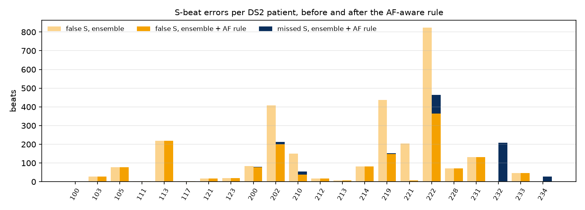
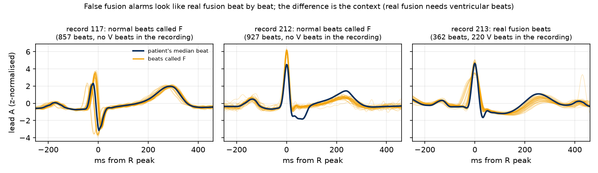
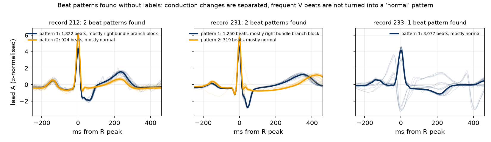
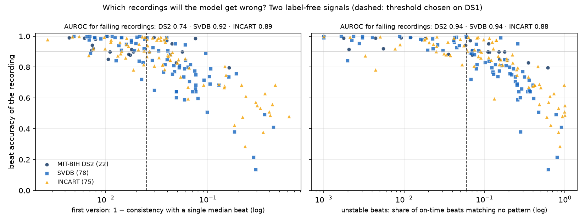
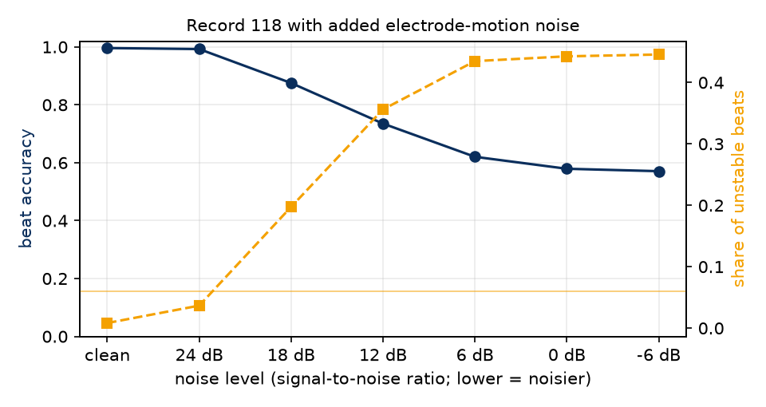

# ECG Arrhythmia Classification on Unseen Patients — and Knowing When Not to Trust the Result

Heartbeat classification (AAMI classes **N, S, V, F**) evaluated the way it would be used in practice:
**the models are tested only on patients they have never seen.** Training uses 18 MIT-BIH patients; testing uses
22 other MIT-BIH patients and two external databases recorded elsewhere. No test set is used for training, tuning or
model selection.

The project then asks a second question that matters just as much in clinical use: **can the system tell, without any
labels, for which recordings its own result should not be trusted, and why?**

**Highlights**
- **Three test sets, no tuning on any of them:** 22 unseen MIT-BIH patients (DS2), the MIT-BIH Supraventricular Arrhythmia
  Database (78 recordings) and the St Petersburg INCART database (75 recordings from 32 patients, different hospital and leads).
- **Patient-relative features**: every beat is compared with the patient's own rhythm and own usual beat. This lifts
  S-beat sensitivity from 6–8% (first version) to 90% with a plain logistic regression.
- **Several "usual beats" per patient.** Most errors of the first version were false fusion alarms: in record 212, whose
  usual beat is right bundle branch block, 917 of its 922
  normally conducted beats were called fusion. The pipeline now finds each patient's beat patterns without labels
  (record 212 splits exactly into its RBBB and normal beats) and compares every beat with its own pattern. False fusion
  alarms in record 212 drop from 927 to 21, and ventricular beats never form a pattern of their own.
- **A fusion gate** (no ventricular beats → no fusion is possible) removes another 39% of the false F alarms on DS2
  (2,239 → 1,360; first version: 4,740 before the gate).
- **A label-free reliability warning with causes.** The share of on-time beats that match none of the patient's own
  patterns predicts which recordings the model will get wrong: with a threshold chosen on training patients only, recordings
  without a warning reach 96.5% / 96.9% / 93.6% beat accuracy
  (DS2 / SVDB / INCART), recordings with a warning 88.7% / 71.2% / 73.7%.
- **Rule vs learned rhythm model.** A joint rhythm-and-beat model was tested instead of the post-hoc AF rule:
  it beats the post-hoc AF rule on INCART but not on DS2 or SVDB, so the rule stays in the main pipeline.
- **Seed ensembling:** a single CNN run varies a lot (DS2 macro-F1 0.619 ± 0.036
  over 10 seeds); averaging 10 seeds gives one stable model.
- **Fully automatic pipeline:** 99.2% QRS detection, with classification on detected beats at the level of
  expert-annotated beats.
- **An honest result:** no single model wins everywhere. On DS2 the main pipeline has the best macro-F1 (0.658); on the two external databases the two-lead CNN is better (0.555 and 0.674 vs 0.528 and 0.490), but it finds far fewer S beats (39% and 78% vs 61% and 96%).


## Why I built this
I'm a software engineering student at Sichuan University, and I work as an intern on a hospital
teleconsultation platform. My own research looks at how unreliable or incomplete clinical data affects
AI-assisted clinical decisions. One question keeps coming back in that work: *does a model still hold up
when it meets a patient it has never seen?*

ECG classification is a good place to test that honestly. MIT-BIH is public and well documented, and many
published results look near-perfect only because the same patients appear in training and testing. I wanted a
project that uses the strict unseen-patient evaluation from the start, finds out *why* models fail on new
patients, and writes down what I learned, including the parts that did not work.

Because my research is about data reliability, the last part of the project turns the question around: instead of
only asking how accurate the model is, it asks whether the system can recognise the recordings where its own output
should not be trusted, before anyone acts on it.

## Why inter-patient matters
Many MIT-BIH papers shuffle all beats and split them randomly, so beats from the same patient appear in
both training and test sets. Accuracy then looks close to 99% but mostly measures how well the model
recognises *people*, not arrhythmias. This project uses the standard inter-patient split of
de Chazal et al. (2004):

| Set | Records | Use |
|---|---|---|
| DS1 (18 patients) | 101, 106, 109, 112, 114, 115, 116, 119, 122, 124, 201, 203, 205, 208, 209, 215, 220, 230 | training |
| DS1 hold-out (4 patients) | 108, 118, 207, 223 | early stopping and ensemble weight only |
| DS2 (22 patients) | 100, 103, 105, 111, 113, 117, 121, 123, 200, 202, 210, 212, 213, 214, 219, 221, 222, 228, 231, 232, 233, 234 | final test, used once |

Paced records (102, 104, 107, 217) are excluded and Q beats are dropped, following AAMI EC57.

## Method
**Beats.** Lead A (MLII on MIT-BIH, ECG1 on SVDB, II on INCART), resampled to 360 Hz, 0.5–40 Hz band-pass filter,
256-sample window around each R peak (0.25 s before, 0.46 s after), z-normalised per beat.

**Patient-relative features.** The key design choice: every beat is described *relative to its own patient*.
- 7 RR-interval features as log ratios to the *local* rhythm (previous 10 beats, surrounding 50 beats, previous RR).
- 4 template features: correlation and RMS distance between the beat and the patient's **nearest beat pattern**,
  for the whole beat and for the QRS complex only.

**Beat patterns (templates).** A patient can have more than one normal conduction pattern (intermittent bundle branch
block, intermittent pre-excitation). For each recording, on-time beats are clustered into up to 3 patterns, without labels.
A pattern is kept only if it covers ≥ 10% of the beats, most of its beats arrive on time, ≥ 50% of its beats come in runs of
≥ 3 consecutive beats (a conduction change lasts a while; ectopic beats are scattered), and it clearly differs from the
other patterns. These rules come from the MIT-BIH training data: conduction changes keep 98–100% of their beats in such runs,
ventricular beats at most 38%.

**Models.**
- **Logistic regression** on the 11 features.
- **1D CNN** (4 conv blocks) whose input is the beat **and** the beat minus its pattern (2 channels), fused with the 11
  features. Class-weighted loss, augmentation (amplitude scaling, baseline wander, noise), early stopping on the held-out
  DS1 patients, 10 seeds averaged.
- **Ensemble:** weighted average of the two models' probabilities, weight chosen on the DS1 hold-out patients.
- **AF-aware rule:** a gradient-boosting detector recognises atrial fibrillation / flutter from rhythm context alone
  (RR irregularity over ±15 beats and P-wave consistency). Inside detected AF, S predictions become N, because by
  definition there are no supraventricular ectopic beats during AF. Model and threshold (0.75) are chosen by
  leave-patient-out cross-validation on DS1. On DS2 the detector reaches AF sensitivity 82.6%, +P 92.8%,
  specificity 98.6%.
- **Fusion gate** (`src/reliability.py`): if the model predicts V for fewer than 1% of a recording's beats, its F
  predictions are replaced by the best of N / S / V. The 1% threshold is fixed in advance, not tuned.
- **Joint rhythm-and-beat model** (`src/joint.py`, experiment): one classifier sees the beat features *and* the rhythm
  context, instead of the post-hoc AF rule. The model family (logistic regression, logistic regression with rhythm × RR interactions, gradient boosting) is chosen by
  leave-patient-out cross-validation on DS1; gradient boosting won.
- **Reliability warning** (`analysis.py`): see [When not to trust a result](#when-not-to-trust-a-result).
- **Two-lead experiment:** the same models with a second lead (V1 on most MIT-BIH records, ECG2 on SVDB, V1 on INCART).

**Three test sets.**
- **DS2:** 22 unseen MIT-BIH patients (49,661 beats).
- **SVDB:** MIT-BIH Supraventricular Arrhythmia Database, 78 recordings at 128 Hz (184,347 beats, 12,194 S beats).
- **INCART:** St Petersburg INCART 12-lead database, 75 recordings from 32 patients at 257 Hz (175,718 beats).

## Results
Se = sensitivity, +P = positive predictivity, in %. Macro-F1 is the mean F1 over N, S, V and F; best value per column in bold.
Full tables (all models) are in [`results/final_results.md`](results/final_results.md).

### DS2 — 22 unseen MIT-BIH patients
| Model | Accuracy | Macro-F1 | N Se / +P | S Se / +P | V Se / +P | F Se / +P |
|---|---|---|---|---|---|---|
| Logistic regression (features) | 85.5% | 0.593 | 85.8 / **99.2** | **90.4** / 31.3 | 82.8 / 92.8 | **52.6** / 6.3 |
| CNN (10-seed ensemble) | **94.3%** | 0.626 | **97.6** / 96.5 | 26.6 / 36.0 | 96.7 / 91.8 | 20.4 / **47.0** |
| Ensemble + AF-aware rule | 90.7% | 0.645 | 91.9 / 98.6 | 79.8 / **48.4** | 87.0 / **93.1** | 45.6 / 7.3 |
| **Ensemble + AF rule + fusion gate (main)** | 92.3% | **0.658** | 93.6 / 98.6 | 80.1 / 48.0 | 87.0 / 90.8 | 45.6 / 11.5 |
| Two-lead CNN | 94.2% | 0.574 | 97.3 / 96.5 | 30.6 / 41.0 | **98.8** / 92.7 | 1.6 / 2.1 |

Compared with the first version (one template per patient, 3 CNN seeds), the main pipeline goes from
90.1% to 92.3% accuracy and from 0.631 to 0.658 macro-F1 on DS2
(SVDB 0.510 → 0.528, INCART 0.461 → 0.490;
first-version tables in [`docs/v1_final_results.md`](docs/v1_final_results.md)).

### External test sets (never used for training or tuning)
| Model | SVDB Acc | SVDB Macro-F1 | SVDB S Se / +P | INCART Acc | INCART Macro-F1 | INCART S Se / +P |
|---|---|---|---|---|---|---|
| Logistic regression | 70.1% | 0.498 | 66.5 / 43.9 | 69.9% | 0.456 | 95.8 / 12.0 |
| CNN | 91.0% | 0.516 | 21.4 / 59.4 | 93.4% | 0.621 | 85.1 / 44.0 |
| **Ensemble + AF rule + fusion gate (main)** | 79.0% | 0.528 | 61.4 / 50.8 | 78.6% | 0.490 | 95.5 / 15.4 |
| Two-lead CNN | 92.7% | 0.555 | 39.5 / 60.1 | 96.9% | 0.674 | 77.7 / 72.6 |

SVDB contains only 23 F beats and INCART 219, so N, V and F columns are in `results/final_results.md`.

### Post-hoc AF rule vs joint rhythm-and-beat model
Both are feature-only models with the fusion gate, so the only difference is how rhythm is used.

| Test set | AF rule: macro-F1 | AF rule: S Se / +P | Joint model: macro-F1 | Joint model: S Se / +P |
|---|---|---|---|---|
| DS2 | 0.630 | 84.7 / 40.1 | 0.593 | 23.9 / 38.2 |
| SVDB | 0.501 | 63.5 / 45.6 | 0.500 | 35.8 / 51.4 |
| INCART | 0.458 | 95.8 / 11.7 | 0.573 | 69.2 / 33.8 |

Leave-patient-out macro-F1 on DS1: logistic regression 0.540, logistic regression with rhythm × RR interactions 0.528, gradient boosting 0.554.
Only 2 of the 18 training patients have atrial fibrillation (records 201 and 203), so a learned rhythm model has very
little AF to learn from; the rule encodes the physiology directly.

### Seed variance and seed ensembling
Macro-F1 of CNN ensembles of k seeds (lead A; mean ± std over random draws of k of the 10 trained seeds):

| Test set | k = 1 | k = 3 | k = 5 | k = 10 |
|---|---|---|---|---|
| DS2 | 0.619 ± 0.036 | 0.624 ± 0.027 | 0.632 ± 0.012 | 0.626 |
| SVDB | 0.509 ± 0.014 | 0.514 ± 0.010 | 0.516 ± 0.005 | 0.516 |
| INCART | 0.587 ± 0.025 | 0.612 ± 0.014 | 0.617 ± 0.005 | 0.621 |

Single seeds on DS2: macro-F1 0.537 to 0.656, S sensitivity
14% to 50% (two leads: macro-F1 0.585 ± 0.034).
All reported CNN rows use the 10-seed ensemble (`results/seed_ensembles.json`, `results/cnn*_seeds.json`).

### Fully automatic pipeline (no expert beat positions)
R peaks found by the XQRS detector (wfdb) instead of the annotations; labels come from the nearest annotation within 150 ms.

| | Result |
|---|---|
| QRS detection, 44 MIT-BIH records (100,733 beats) | Se **99.17%**, +P **99.29%** |
| Logistic regression on detected beats, DS2 | macro-F1 **0.599** · S 84.6 / 29.9 · V 86.6 / 95.8 |

## Where the errors come from

### S errors: atrial fibrillation


During AF the rhythm is irregular, so normal beats often arrive "early", which is exactly what an S beat looks like to
an RR-based model. On DS2 the AF rule removes 1,270 false S alarms at the cost of 113 missed S beats.
The per-patient table is in [`results/final_results.md`](results/final_results.md).

### F errors: one "normal" class, several shapes
In the first version, 4,740 errors on DS2 were beats wrongly called fusion (F). They were not random:
AAMI's N class merges normal beats with bundle branch block and escape beats, and a model that compares every beat with
*the patient's single usual beat* sees the minority pattern as "on time, but a different shape", which is exactly the
signature of a fusion beat.



- **Record 212** has 1,824 right bundle branch block beats and 922 normally conducted beats;
  917 of the normally conducted beats were called F.
- **Record 231** has the same mix: all 314 of its normally conducted beats were called F.

Two fixes, one at the root and one as a safety net:
1. **Several beat patterns per patient.** The patterns are found without labels; the table compares them with the
   original MIT-BIH annotations (top two beat types per pattern):

| Record | Set | Pattern 1 | Pattern 2 | Pattern 3 |
|---|---|---|---|---|
| 230 | DS1 | 1,336 normal, 1 ventricular | 917 normal | – |
| 108 | DS1 hold-out | 885 normal, 10 ventricular | 453 normal, 1 atrial premature | 399 normal, 7 ventricular |
| 111 | DS2 | 1,208 LBBB | 913 LBBB, 1 ventricular | – |
| 117 | DS2 | 880 normal | 652 normal, 1 atrial premature | – |
| 212 | DS2 | 1,820 RBBB, 2 normal | 920 normal, 4 RBBB | – |
| 231 | DS2 | 1,249 RBBB, 1 atrial premature | 314 normal, 3 RBBB | – |

   Records 212, 231 and 230 are real conduction changes (bundle branch block and intermittent pre-excitation). In 108, 111
   and 117 a single beat type is split into two shapes: in 117 the shape changes partway through the recording, in 108 and
   111 the two shapes alternate throughout; the labels do not say why. No pattern is made of ventricular beats (largest V
   share in any pattern: 1.7%). False F alarms before the gate: record 212 927 → 21,
   record 231 318 → 2, record 117 857 → 62.



2. **Fusion gate.** Real fusion needs ventricular beats, so F predictions are dropped in recordings with almost no
   predicted V beats:

| Test set | False F alarms | Accuracy | Macro-F1 | F Se | F +P |
|---|---|---|---|---|---|
| DS2 | 2,239 → 1,360 | 90.7% → 92.3% | 0.645 → 0.658 | 45.6% → 45.6% | 7.3% → 11.5% |
| SVDB | 29,712 → 25,098 | 76.6% → 79.0% | 0.525 → 0.528 | 47.8% → 4.3% | 0.0% → 0.0% |
| INCART | 28,427 → 25,379 | 77.0% → 78.6% | 0.488 → 0.490 | 48.4% → 47.9% | 0.4% → 0.4% |

On the external databases most false F alarms happen in recordings where the model also predicts some V beats, so the gate
does not switch on; on SVDB it also removes most of the 23 real F beats.

## When not to trust a result
A clinician reading a remote recording needs to know more than "the model is 90% accurate on average": they need to know
whether *this* recording's result is usable, and if not, why. Three label-free signals, computed per recording
(thresholds chosen on DS1 patients only):

- ⚠ **Unstable beats** (the warning): share of on-time beats that match none of the patient's own beat patterns
  (correlation < 0.9). Warning above **6%**. Noise, electrode problems, or shapes the model has not seen.
- **Frequent early beats** (information): more than **5%** of beats arrive > 15% early (ectopy or irregular rhythm).
- **Several beat patterns** (information): the patient switches between beat shapes.



A recording "fails" when its beat accuracy is below 90%. The first version of the flag (median correlation with a single
median beat < 0.975) is shown for comparison.

| Test set | Signal | Flagged | Failing | Failing and flagged | Flagged but fine | Accuracy, not flagged | Accuracy, flagged | AUROC |
|---|---|---|---|---|---|---|---|---|
| DS2 | first version | 8 | 9 | 4 | 4 | 93.0% | 91.0% | 0.74 |
| DS2 | **unstable beats** | 11 | 9 | 8 | 3 | 96.5% | 88.7% | 0.94 |
| SVDB | first version | 50 | 47 | 42 | 8 | 94.5% | 71.6% | 0.92 |
| SVDB | **unstable beats** | 51 | 47 | 46 | 5 | 96.9% | 71.2% | 0.94 |
| INCART | first version | 51 | 46 | 40 | 11 | 92.9% | 73.2% | 0.89 |
| INCART | **unstable beats** | 52 | 46 | 40 | 12 | 93.6% | 73.7% | 0.88 |

**Why the causes matter.** Accuracy by cause (pooled over beats, number of recordings in brackets):

| Test set | No warning, no early beats | Frequent early beats only | Unstable beats |
|---|---|---|---|
| DS2 | 98.3% (8) | 91.9% (3) | 88.7% (11) |
| SVDB | 98.2% (19) | 94.3% (8) | 71.2% (51) |
| INCART | 95.7% (8) | 92.5% (15) | 73.7% (52) |

Frequent early beats on their own are not a reason to distrust the result: those recordings reach at least
91.9% accuracy on every test set, while recordings with unstable beats drop to
88.7% / 71.2% / 73.7%. Per-recording summaries for DS2 (status, causes, AF / V / S burden) are in
[`results/reliability.md`](results/reliability.md).

**Recording-level burden.** The predicted V burden falls in the right category (<1%, 1–10%, ≥10% of beats) for
82% of DS2 recordings (91% of those without a warning); S burden is much less reliable
(32%), because false S alarms inflate it.

## Extensions
Three follow-up studies (`extensions.py`, full tables in [`results/extensions.md`](results/extensions.md)). None of them
changes the main pipeline.

**1. Noise stress test: does the warning notice noise?** Record 118, a DS1 hold-out patient the models never trained on (it is used only for early stopping),
with electrode-motion noise added at six levels (MIT-BIH Noise Stress Test Database; noise in alternating 2-minute blocks):

| Noise level (SNR) | Beat accuracy | Unstable beats | Warning |
|---|---|---|---|
| clean | 99.6% | 0.8% | no |
| 24 dB | 99.2% | 3.7% | no |
| 18 dB | 87.5% | 19.7% | ⚠ yes |
| 12 dB | 73.5% | 35.6% | ⚠ yes |
| 6 dB | 62.0% | 43.5% | ⚠ yes |
| 0 dB | 57.9% | 44.3% | ⚠ yes |
| -6 dB | 57.1% | 44.6% | ⚠ yes |

The warning, with the threshold chosen on DS1 before this test, switches on at 18 dB, the first level where accuracy clearly drops
(87.5%), and stays on for every noisier level.



**2. A rhythm model with more AF patients.** Adding the 23 recordings of the MIT-BIH Atrial Fibrillation Database
(130,026 AF beats used) to the 2 AF patients of DS1 changes the AF detector on DS2 from sensitivity
82.6% / +P 92.8% to 94.9% / 79.4%: it finds more AF but raises more false AF alarms.

| Test set | Main pipeline, macro-F1 | Same, AF detector with the AF database | Joint model with the AF probability |
|---|---|---|---|
| DS2 | 0.658 | 0.658 | 0.588 |
| SVDB | 0.528 | 0.521 | 0.506 |
| INCART | 0.490 | 0.495 | 0.591 |

More AF patients do not change the main pipeline much, and the joint model again wins only on INCART: the lack of AF
patients was not the main reason the joint model fell behind the rule on DS2 and SVDB.

**3. Real-time version.** Every feature uses past beats only, plus the next R peak (a one-beat delay); beat patterns are
re-estimated every 50 beats from the previous 300, and the fusion gate uses the share of V beats seen so far. A test that cuts
a recording right after a beat confirms that the beat's features do not change. Trained and evaluated the same way as the
main pipeline, with 5 CNN seeds instead of 10:

| Test set | Offline: accuracy / macro-F1 | Real-time: accuracy / macro-F1 | S sensitivity |
|---|---|---|---|
| DS2 | 92.3% / 0.658 | 93.6% / 0.660 | 80% → 63% |
| SVDB | 79.0% / 0.528 | 88.6% / 0.578 | 61% → 53% |
| INCART | 78.6% / 0.490 | 87.9% / 0.557 | 96% → 93% |

The real-time version is not worse, and is better on the two external databases. Two things differ at once, so the gain
cannot be credited to one of them: its patterns adapt to slow changes during a recording, and the ensemble weight chosen on
the DS1 hold-out gives the CNN more weight (0.50 vs 0.25 offline). It finds fewer S beats on DS2
(63% vs 80%), and its AF detector is weaker without future beats
(sensitivity 70.3% vs 82.6%).

## What I learned
1. **Normalisation decides S detection.** In the first version, RR intervals were divided by each patient's
   median RR, and both models (random forest and CNN) found only 6–8% of S beats. The cause is record 232: it contains
   1,381 of the 1,836 S beats in DS2, and S beats are the *majority* of its beats, so the "patient median" was itself an
   S rhythm. Local rhythm ratios plus template features raised S sensitivity above 90% with a simple logistic regression.
2. **Patient-relative features cut both ways.** Comparing each beat with the patient's own usual beat is what makes the
   model work on new patients, and it also created most of its errors: a patient with two conduction patterns has no single
   "usual beat". Letting each patient have several patterns fixed this at the root, without labels.
3. **Check that a fix transfers.** Rescaling the F probability looked better on the training patients and removed every F
   prediction on all three test sets. The joint rhythm-and-beat model beats the post-hoc AF rule on INCART but not on DS2 or SVDB, so the rule stays in the main pipeline. The two rules that encode one physiological fact each (no S beats inside AF; no fusion
   without ventricular beats) have no tuned parameter and did not lower macro-F1 on any test set.
4. **A model should know when it is on unfamiliar ground, and say why.** One label-free number, computed per recording,
   separates recordings the pipeline handles well from recordings it does not, on two databases it never saw. Splitting the
   warning into causes showed that "unusual" is not the same as "unreliable": frequent early beats are fine, unstable beats are not.
5. **One training run is not a result.** Single CNN seeds trained the same way give DS2 macro-F1 between
   0.54 and 0.66; only the averaged ensemble should be reported.
6. **Accuracy is misleading.** The most accurate model on each test set is a CNN, and it finds fewer S beats than the logistic regression.

## Limitations
- The second lead is not the same lead everywhere (V1 on 38 of the 44 MIT-BIH records, V2, V4 or V5 on the others; ECG2 on SVDB),
  and SVDB's first channel (ECG1) is not necessarily MLII. SVDB and INCART are resampled to 360 Hz.
- F (fusion) beats remain hard: 398 training beats, mostly from one patient. The fusion gate only removes false F alarms
  in recordings without predicted V beats, and on SVDB it removes most of the 23 real F beats.
- The pattern rules (10% coverage, runs of 3 beats, correlation 0.9 / 0.95) were set by looking at MIT-BIH training
  records; in some recordings (108, 111, 117) they split one beat type into two shapes.
- The reliability thresholds are chosen on 22 DS1 recordings, and "unstable beats" does not yet separate noise from
  shapes that are real but rare.
- Only 2 training patients have atrial fibrillation, which limits any learned rhythm model.
- The S class in DS2 is dominated by one patient (232), so DS2 S metrics depend heavily on that record.
- INCART's 75 recordings come from 32 patients, so its recordings are not independent.
- The main pipeline uses the whole recording (patient patterns, RR context after the beat), like an offline Holter
  analysis; the real-time version is an extension, and the warning itself is computed per recording.

## What was built, step by step
- [x] Ensemble: logistic regression for S detection + CNN for N/V precision
- [x] Per-patient error analysis (which records fail, and why)
- [x] External validation on a second database (MIT-BIH Supraventricular Arrhythmia Database)
- [x] Automatic R-peak detection instead of annotated peaks
- [x] AF-aware rule: detect the rhythm first, then correct S predictions
- [x] Two-lead input and a third database with a different lead setup (St Petersburg INCART)
- [x] Explain and reduce false F alarms (fusion gate)
- [x] Label-free reliability flag per recording
- [x] Several templates per patient (one per conduction pattern) instead of a single median beat
- [x] Separate the reliability flag into causes (unstable beats vs frequent early beats vs several patterns)
- [x] Joint rhythm-and-beat model instead of a post-hoc AF rule (tested; the rule transfers better on 2 of 3 test sets)
- [x] More seeds and seed ensembling to reduce CNN variance

- [x] Rhythm model trained with more AF patients (MIT-BIH Atrial Fibrillation Database), joint model retried
- [x] Unstable-beats warning validated against recordings with known added noise (MIT-BIH Noise Stress Test Database)
- [x] Real-time version that only uses past beats

## Reproduce
```bash
python3.12 -m venv .venv && source .venv/bin/activate
pip install -r requirements.txt
bash scripts/download_mitdb.command      # MIT-BIH Arrhythmia Database (~100 MB)
bash scripts/download_svdb.command       # MIT-BIH Supraventricular Arrhythmia Database (~55 MB)
bash scripts/download_incart.command     # St Petersburg INCART (~800 MB, optional)
bash scripts/run_all.command             # features, baselines, detection, CNNs, AF detector, evaluation, analysis, plots
bash scripts/update_results.command      # re-run evaluation + analysis only, with the trained CNNs (1-2 minutes)
bash scripts/download_extra.command      # extensions: Noise Stress Test (~5 MB) + Atrial Fibrillation Database (~650 MB)
bash scripts/run_extensions.command      # real-time CNN + the three extension studies
```
Downloads are resumable. If INCART is not downloaded, `evaluate.py` skips it. Runs on Apple Silicon (MPS), CUDA or CPU.
The `.command` scripts are plain bash scripts and run on macOS and Linux.

## Project structure
```
src/data.py          beat extraction, beat patterns per patient, RR + template + rhythm features, R-peak detection, loaders
src/model.py         BeatNet (1D CNN over beat + beat-minus-pattern, fused with the features)
src/af.py            AF detector (leave-patient-out CV on DS1) and the AF-aware rule
src/joint.py         joint rhythm-and-beat model (experiment)
src/reliability.py   fusion gate, label-free reliability signals and causes, per-recording summaries
src/metrics.py       AAMI per-class metrics and confusion matrices
baseline.py          logistic regression and gradient boosting (features only)
detection.py         QRS detector evaluation + fully automatic pipeline
train.py             CNN training (10 seeds; --leads 1 or 2)
evaluate.py          ensembles, AF rule, fusion gate, joint model, seed ensembling, evaluation on DS2 / SVDB / INCART
analysis.py          recording-level analysis: beat patterns, false fusion alarms, reliability warning, ectopic burden
extensions.py        noise stress test, rhythm model with more AF patients, real-time version
scripts/             data downloads, full pipeline, evaluation-only update, comparison plot
results/             metrics, plots, final_results.md and reliability.md (see results/README.md for an index)
docs/                first-version results (one template per patient), kept for comparison
```

## Data and references
- Moody GB, Mark RG. The impact of the MIT-BIH Arrhythmia Database. *IEEE Eng Med Biol* 20(3):45–50, 2001.
- Greenwald SD. *Improved detection and classification of arrhythmias in noise-corrupted electrocardiograms using
  contextual information.* Thesis, Harvard-MIT Division of Health Sciences and Technology, 1990. (SVDB)
- St Petersburg INCART 12-lead Arrhythmia Database, PhysioNet. doi:10.13026/C2V88N
- Goldberger AL et al. PhysioBank, PhysioToolkit, and PhysioNet. *Circulation* 101(23):e215–e220, 2000.
- Pollard T et al. PhysioNet as a global platform for biomedical research. *Nature Health*, 2026. doi:10.1038/s44360-026-00096-z
- de Chazal P, O'Dwyer M, Reilly RB. Automatic classification of heartbeats using ECG morphology and heartbeat
  interval features. *IEEE Trans Biomed Eng* 51(7):1196–1206, 2004.

## License
Code: MIT (see `LICENSE`). The ECG data are not included; they are distributed by PhysioNet under their own licenses.
This is a research/portfolio project and is not a medical device.

## Author
**Amina El Hasnaouy** · Software Engineering, Sichuan University · [GitHub](https://github.com/AMINA-ELHASNAOUY)
