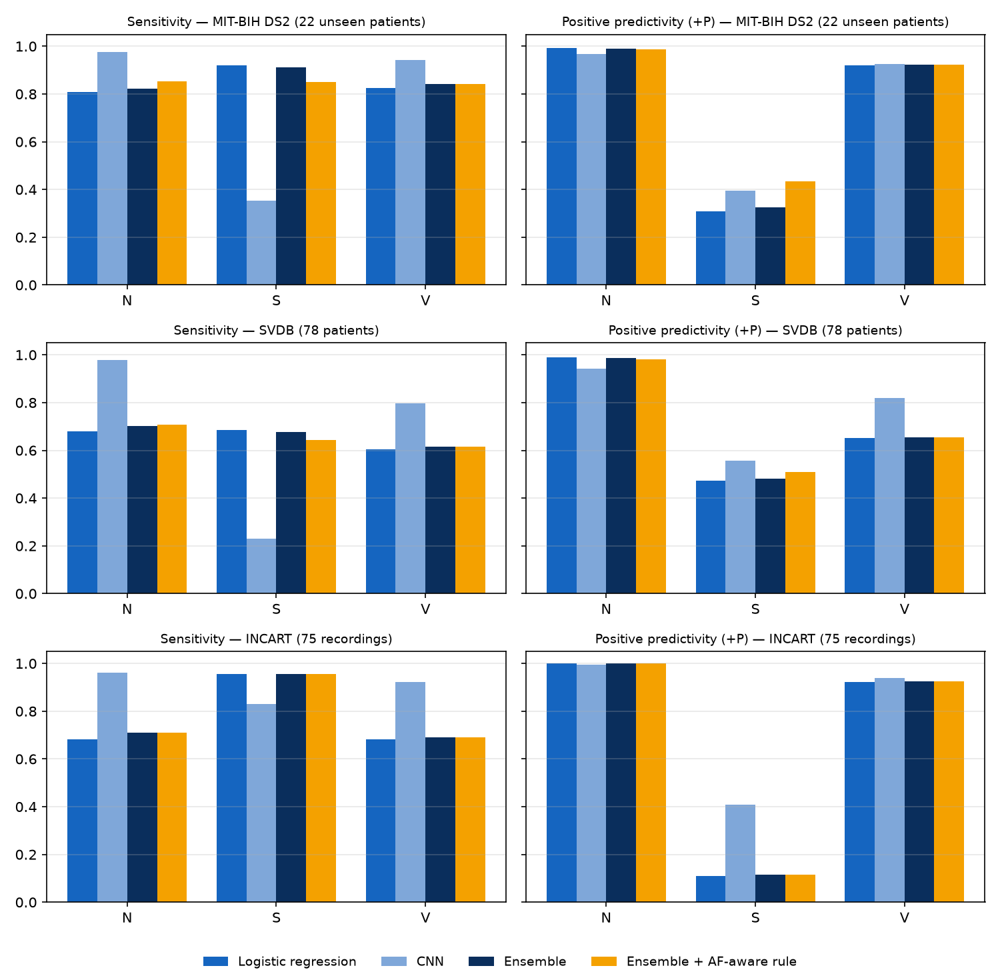

# ECG Arrhythmia Classification — Inter-Patient Evaluation on MIT-BIH

Heartbeat classification (AAMI classes **N, S, V, F**) evaluated the way it would be used in practice:
**the model is tested only on patients it has never seen**. Training and test beats never come from the same person.



## Why I built this
I'm a software engineering student at Sichuan University, and I work as an intern on a hospital
teleconsultation platform. My own research looks at how unreliable or incomplete clinical data affects
AI-assisted clinical decisions. One question keeps coming back in that work: *does a model still hold up
when it meets a patient it has never seen?*

ECG classification is a good place to test that honestly. MIT-BIH is public and well documented, and many
published results look near-perfect only because the same patients appear in training and testing. I wanted a
project that uses the strict unseen-patient evaluation from the start, finds out *why* models fail on new
patients, and writes down what I learned, including the parts that did not work.

## Why inter-patient matters
Many MIT-BIH papers shuffle all beats and split them randomly, so beats from the same patient appear in
both training and test sets. Accuracy then looks close to 99% but mostly measures how well the model
recognises *people*, not arrhythmias. This project uses the standard inter-patient split of
de Chazal et al. (2004):

| Set | Records | Use |
|---|---|---|
| DS1 (18 patients) | 101, 106, 109, 112, 114, 115, 116, 119, 122, 124, 201, 203, 205, 208, 209, 215, 220, 230 | training |
| DS1 hold-out (4 patients) | 108, 118, 207, 223 | early stopping only |
| DS2 (22 patients) | 100, 103, 105, 111, 113, 117, 121, 123, 200, 202, 210, 212, 213, 214, 219, 221, 222, 228, 231, 232, 233, 234 | final test, used once |

Paced records (102, 104, 107, 217) are excluded and Q beats are dropped, following AAMI EC57.

## Method
**Beats.** Lead MLII, 0.5–40 Hz band-pass filter, 256-sample window around each annotated R peak
(0.25 s before, 0.46 s after), z-normalised per beat.

**Patient-relative features.** The key design choice: every beat is described *relative to its own patient*.
- 7 RR-interval features as log ratios to the *local* rhythm (previous 10 beats, surrounding 50 beats, previous RR).
- 4 template features: correlation and RMS distance between the beat and the patient's median beat,
  for the whole beat and for the QRS complex only. The template is computed from the unlabeled signal.

**Models.**
- Logistic regression and gradient boosting on the 11 features.
- 1D CNN (4 conv blocks) whose input is the beat **and** the beat minus the patient template (2 channels),
  fused with the 11 features. Class-weighted loss, augmentation (amplitude scaling, baseline wander, noise),
  early stopping on the held-out DS1 patients. Trained with 3 seeds; results are reported as mean ± std.

## Results (DS2, 49,661 beats from 22 unseen patients)

| Model | Accuracy | Macro-F1 | N Se / +P | S Se / +P | V Se / +P | F Se / +P |
|---|---|---|---|---|---|---|
| Logistic regression (features) | 81.0% | **0.582** | 80.3 / **99.2** | **93.4** / 31.8 | 87.3 / **93.1** | **49.7** / 3.5 |
| Gradient boosting (features) | 88.0% | 0.567 | 90.0 / 97.1 | 43.1 / 24.7 | 92.7 / 84.2 | 40.5 / 8.2 |
| CNN (waveform + features), 3 seeds | **94.1 ± 0.2%** | 0.554 ± 0.016 | **98.0** / 96.1 | 20.3 / 31.7 | **92.8** / 92.9 | 4.8 / 12.4 |

Se = sensitivity (recall), +P = positive predictivity (precision), in %.
Test support: N 44,218 · S 1,836 · V 3,219 · F 388.

## What I learned
1. **Normalisation decides S detection.** In the first version, RR intervals were divided by each patient's
   median RR, and S sensitivity was only 6%. The cause is record 232: it contains 1,381 of the 1,836 S beats in DS2,
   and S beats are the *majority* of its beats, so the "patient median" was itself an S rhythm. Switching to
   local rhythm ratios plus template features raised S sensitivity of the same linear model to 93%.
2. **Model capacity is not the bottleneck.** A logistic regression on 11 well-designed features gives the best
   macro-F1 and by far the best S sensitivity. The CNN has the highest accuracy and N/V performance but
   leans towards the majority class and misses most S beats from unseen patients.
3. **F (fusion) beats remain unsolved.** There are only 398 F beats in training, most from a single patient,
   and they look like a blend of N and V. No model exceeds 13% positive predictivity.
4. **Accuracy is misleading here.** The CNN's 94% accuracy and the logistic regression's 81% describe very different
   clinical behaviour; per-class sensitivity and +P are the numbers that matter.

## Limitations
- Single lead (MLII) and a single database; no external validation set (e.g. INCART, MIT-BIH Supraventricular).
- R-peak positions come from the expert annotations, not from an automatic detector.
- The S class in DS2 is dominated by one patient (232), so S metrics are sensitive to that record.

## Next steps
- [ ] Ensemble: logistic regression for S detection + CNN for N/V precision
- [ ] Per-patient error analysis (which records fail, and why)
- [ ] External validation on a second database (St Petersburg INCART)
- [ ] Automatic R-peak detection instead of annotated peaks

## Reproduce
```bash
python3.12 -m venv .venv && source .venv/bin/activate
pip install -r requirements.txt
bash scripts/download_mitdb.command      # MIT-BIH from PhysioNet, resumable (~100 MB)
bash scripts/run_all.command             # features, baselines, CNN (3 seeds), plots -> results/
```
Runs on Apple Silicon (MPS), CUDA or CPU. The full CNN run takes about 3.5 minutes on an Apple M-series laptop.

## Project structure
```
src/data.py        beat extraction, RR and template features, DS1/DS2 split
src/model.py       BeatNet (2-channel 1D CNN + feature branch)
src/metrics.py     AAMI per-class metrics and confusion matrices
baseline.py        logistic regression and gradient boosting
train.py           CNN training (multi-seed) and DS2 evaluation
scripts/           data download, full pipeline, comparison plot
results/           metrics (JSON), confusion matrices, training curve
```

## Data and reference
- Moody GB, Mark RG. The impact of the MIT-BIH Arrhythmia Database. *IEEE Eng Med Biol* 20(3):45–50, 2001.
- Goldberger AL et al. PhysioBank, PhysioToolkit, and PhysioNet. *Circulation* 101(23):e215–e220, 2000.
- de Chazal P, O'Dwyer M, Reilly RB. Automatic classification of heartbeats using ECG morphology and heartbeat
  interval features. *IEEE Trans Biomed Eng* 51(7):1196–1206, 2004.

## Author
**Amina El Hasnaouy** · Software Engineering, Sichuan University · [GitHub](https://github.com/AMINA-ELHASNAOUY)
